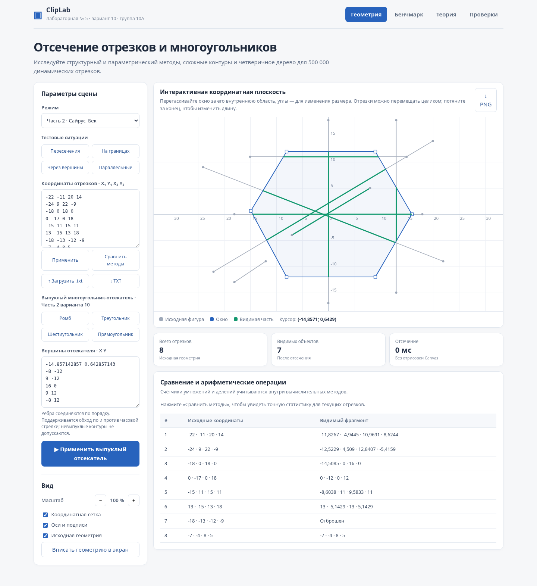

# Лабораторная работа № 5 — ClipLab

**Дисциплина:** Математические методы компьютерной графики  
**Тема:** Алгоритмы отсечения отрезков и многоугольников  
**Вариант:** **10** (чётный)  
**Группа:** **10А**  
**Формат:** автономное веб-приложение (HTML, CSS, JavaScript, Canvas 2D, WebGL2 при наличии), без сторонних JS-библиотек.



## 1. Запуск

1. Откройте `index.html` в Chrome, Firefox или Edge. Интернет и установка зависимостей не требуются.
2. Выберите режим в панели слева. В режиме больших данных нажмите «Создать набор и индекс».
3. При работе с исходниками (необязательно) установите Node.js 20+ и используйте:

```bash
npm test
npm run test:stress
npm run benchmark
python3 scripts/generate_report.py
npm run build
```

`npm run build` собирает **тот же автономный `index.html`** из `template.html`, `styles.css` и `src/*.js`. Исходники сохранены раздельно для проверки преподавателем. Браузерные вычисления запускаются в Web Worker без внешних сетевых запросов.

## 2. Что реализовано для варианта 10

**Часть 1. Коэн–Сазерленд.** Отсечение отрезков прямоугольным окном: `clipCohen()` в `src/geometry.js`. Используются четырёхбитные коды LEFT, RIGHT, BOTTOM, TOP, тривиальное принятие (`OR == 0`), тривиальная отбраковка (`AND != 0`) и вычисление пересечения с явно заданными прямыми окна. Работа выполняется в исходных геометрических координатах.

**Часть 2. Отсечение отрезков выпуклым многоугольником.** Реализован **Сайрус–Бек** (`clipCyrusBeck()` в `src/geometry.js`), с параметрическим представлением отрезка и сужением диапазона `t ∈ [0,1]` по каждому ребру. Есть режим «Часть 2 · Сайрус–Бек», четыре заготовки отсекателей и редактор вершин. Можно использовать правильный или обратный порядок обхода. Выпуклость проверяется; невыпуклые и самопересекающиеся отсекатели отвергаются. Кликните по вершине на холсте для перемещения; все изменения проверяются на сохранение выпуклости.

**Дополнение 10А по сравнению алгоритмов.** Отдельно реализован **Лианг–Барски** (`clipLiang()`) как второй подход для прямоугольного отсечения. Кнопка «Сравнить методы» измеряет количество вызовов операций `×` и `÷` внутри алгоритмов и проверяет совпадение видимых фрагментов. Основной алгоритм варианта 10 по умолчанию — Коэн–Сазерленд.

**Дополнение 10А по многоугольникам.** Режим «Многоугольники» реализует обход связанных контуров **Уайлера–Атертона** для простых пересечений (`clipWeilerAthertonSimple()`) и расширенный графовый метод пересечений и ориентированных границ (`clipPolygonGraph()`) для самопересечений, вогнутостей, нескольких компонентов и отверстий. Для многоугольников действует правило чётности even-odd. Никакое растровое закрашивание не используется как метод геометрического отсечения; Canvas только рисует результат.

## 3. Как пользоваться

**Отрезки:** выберите «Часть 1 · Коэн–Сазерленд», задайте отрезки по строкам `X1 Y1 X2 Y2`, выберите ситуацию или загрузите `.txt`, нажмите «Применить». Выберите дополнительный Лианг–Барски для сравнения. Исходные отрезки серые, окно синее, видимые фрагменты зелёные. Точки нулевой длины отображаются отдельными маркерами.

**Выпуклый отсекатель:** выберите «Часть 2 · Сайрус–Бек». Отрезки редактируются в той же форме, а вершины отсекателя — ниже. Перетащите отдельную вершину или весь выпуклый контур. Попытка сделать многоугольник невыпуклым не применяется. Прямоугольные поля `Xmin/Xmax` в этом режиме не нужны и скрываются.

**Произвольные многоугольники:** выберите «Многоугольники». Введите вершины `X Y` по одной на строку; пустая строка отделяет внешние контуры/отверстия. Нажмите «Отсечь многоугольник». Доступны примеры «Вогнутый», «Распад области», «Отверстие», «Самопересечение», «Вершины окна», «Совпадение ребра».

**Перетаскивание и масштаб:** двигайте прямоугольное окно за внутреннюю область, тяните углы для изменения ширины и высоты. В двух режимах отрезков двигайте отрезок за линию или его концы за маркеры. Колесо мыши меняет масштаб, движение мыши вне объекта — панорамирование камеры. Также есть кнопки `+`, `−`, «Вписать геометрию в экран».

**Большие данные:** в режиме «500 000+ · Quadtree» выберите объём от 100 000 до 800 000, плотность и глубину индекса. Нажмите «Создать набор и индекс», затем «Анимация 500 000 отрезков». По умолчанию у **каждого отрезка собственное периодическое смещение**: для запроса строятся координаты на указанное время, а Quadtree безопасно расширяет область поиска на максимально возможное смещение 3 единицы. В дополнение движется вся сцена относительно окна. Дерево не нужно перестраивать на каждом кадре. Без анимации набор статичен. Показаны полное число видимых фрагментов, AABB-отбраковка, кандидаты, время запроса, FPS рендеринга и частота точных геометрических запросов.

**Графики и проверка:** раздел «Бенчмарк» выполняет собственные измерения без заранее подставленных значений и строит два графика. Раздел «Проверки» содержит 20 встроенных тестов. Полный аналитический отчёт и ещё один график зависимости от плотности находятся в `REPORT.md` и `reports/`.

## 4. Входной формат отрезков

Формат `.txt` точно соответствует заданию:

```text
n
X1_1 Y1_1 X2_1 Y2_1
X1_2 Y1_2 X2_2 Y2_2
...
X1_n Y1_n X2_n Y2_n
Xmin Ymin Xmax Ymax
```

В `examples/segments.txt` и `examples/variant10-segments.txt` — примеры; в `examples/boundaries.txt` — граничные случаи. Есть импорт, проверка валидности и экспорт TXT в том же формате. В ручном режиме ограничение 30 000 строк установлено только для удобства работы с большим текстовым полем; 500 000+ отрезков обрабатываются в отдельном потоковом режиме. Координаты сохраняют достаточную десятичную точность при экспорте.

## 5. Численная устойчивость

Константа `EPS = 1e-7` используется при геометрической классификации. Оба прямоугольных алгоритма используют **одну и ту же замкнутую ε-расширенную область** `xmin-EPS .. xmax+EPS`, `ymin-EPS .. ymax+EPS`, предотвращая возникновение «пересечений» за концами исходного отрезка при близости к границе. При вычислении параметра используются дополнительные машинные допуски для контроля ошибок округления и деления на очень маленькую величину. Сайрус–Бек использует допуск в единицах длины: `EPS * |ребро|` в ориентированном векторном произведении.

Исходные данные из генератора и вычисления хранятся в **64-битном формате (`Float64Array`, JavaScript `Number`)**. В более компактный `Float32Array` преобразуются только координаты для GPU/Canvas-буфера уже после геометрических вычислений: это не меняет результаты отсечения.

Проверены отрезки на границе, отрезки нулевой длины в вершинах окна, касания вершин, параллельность, ε-близкие конфигурации и тонкие фигуры. Алгоритмы сравнивались на дополнительной целенаправленной выборке из 300 000 почти граничных отрезков; расхождений нет. Для многоугольников проведены независимые сравнения площадей пересечения с Shapely на 1 178 простых, вогнутых, тонких и имеющих отверстия примерах (это **контрольные испытания, не внешняя зависимость приложения**; повторяются командой `python3 tests/verify_polygons_with_shapely.py` при установленной Shapely).

## 6. AABB, Quadtree и ускорение

До точной обработки применяются AABB-битовые маски. Quadtree помещает отрезок в дочерний узел только если вся его AABB помещается в один квадрант; иначе отрезок остаётся у родителя. Это исключает пропуски на границах узлов. Запрос рекурсивно исключает целые непересекающиеся поддеревья. При независимом движении консервативная граница смещения увеличивает область поиска; каждый кандидат проверяется уже по **актуальным** координатам. Это предотвращает пропуск динамических отрезков.

Алгоритмическая сложность Quadtree зависит от геометрии и плотности: близкое к `O(log N)` поведение возможно на благоприятных запросах, но при пересечении окна с большой частью набора худший случай достигает `O(N)`. Реальный выигрыш отражён в аналитическом отчёте.

Для отрисовки большого числа отрезков используется WebGL2 с отсечением по scissor-области, а если WebGL2 недоступен — Canvas 2D с единым пакетным контуром. Прежнего искусственного лимита в 12 000 линий **нет**. Визуальный буфер включает небольшую дополнительную область вокруг окна, чтобы при перемещении сцены не появлялись пропуски между ответами Worker. Частота отображения и частота математического пересчёта считаются отдельно. Достижение 60 FPS зависит от устройства, браузера, плотности и размеров окна; это измеряемая цель, а не гарантия для любого случая.

## 7. Структура проекта

| Файл | Назначение |
|---|---|
| `index.html` | Полностью автономное приложение |
| `template.html`, `styles.css` | Разметка и оформление в стиле предыдущей лабораторной |
| `src/geometry.js` | EPS, битовые маски, Коэн–Сазерленд, Лианг–Барски, Сайрус–Бек, TXT |
| `src/polygons.js` | Уайлер–Атертон, граф границ, самопересечения, отверстия |
| `src/quadtree.js` | Четверичное дерево и поиск кандидатов |
| `src/dataset.js` | Детерминированный генератор, Float64Array |
| `src/analysis.js` | Сканирование, независимая анимация, статистика, бенчмарк |
| `src/worker.js` | Вычисления без блокирования интерфейса |
| `src/stress-gpu.js` | Пакетное WebGL2-отображение |
| `src/app.js` | Визуализация, обработчики мыши, управление и графики |
| `tests/` | Node.js-тесты и независимый нагрузочный сценарий 500 000 |
| `REPORT.md`, `reports/` | Аналитика, таблицы и графики |
| `docs/DEFENSE.md` | Пошаговая защита именно варианта 10 |
| `docs/VALIDATION.md` | Таблица соответствия каждому пункту задания |

В проекте нет обязательных npm-зависимостей. Достаточно открыть `index.html`.
