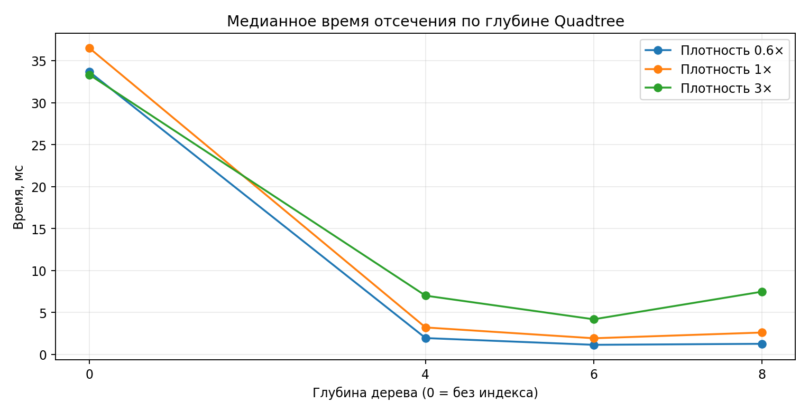
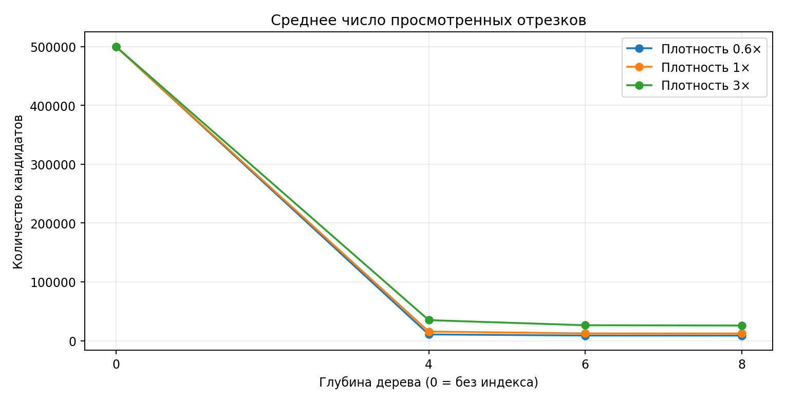
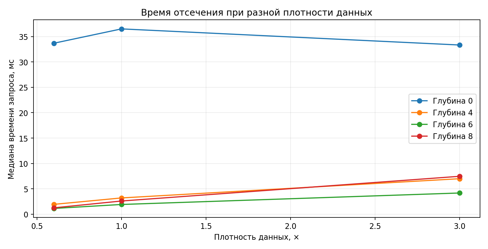

# Аналитический отчёт — лабораторная №5 (группа 10А)

## Постановка эксперимента

Проверено **500 000 отрезков** с детерминированным seed = **2026**. 
Для каждой комбинации плотности и глубины проведено **16** запросов, 
использованы одинаковые координаты отрезков и одинаковые окна. Медиана и p95 рассчитываются по фактическим временам запросов. 
В измерение включены обход индекса, AABB-битовые маски и Коэн–Сазерленд (вариант 10), но исключены генерация данных, построение индекса, Canvas и DOM. 
**Среда:** Node.js/22; **дата:** 2026-11-03T10:43:24.164Z. 
Время может существенно отличаться на другом оборудовании.

## Измеренные результаты

| Плотность | Глубина | Индекс, мс | Медиана запроса, мс | p95, мс | Кандидатов в среднем | Узлов дерева |
|---:|---:|---:|---:|---:|---:|---:|
| 0.6× | 0 | 0,00 | 33,69 | 49,51 | 500 000 | 0 |
| 0.6× | 4 | 152,00 | 1,94 | 9,08 | 10 682 | 341 |
| 0.6× | 6 | 267,41 | 1,13 | 2,28 | 8 790 | 5 461 |
| 0.6× | 8 | 484,17 | 1,25 | 6,19 | 8 690 | 23 873 |
| 1× | 0 | 0,05 | 36,51 | 70,51 | 500 000 | 0 |
| 1× | 4 | 120,40 | 3,20 | 12,24 | 15 576 | 341 |
| 1× | 6 | 225,83 | 1,91 | 4,96 | 12 450 | 4 965 |
| 1× | 8 | 382,10 | 2,60 | 5,83 | 12 288 | 19 369 |
| 3× | 0 | 0,00 | 33,33 | 146,65 | 500 000 | 0 |
| 3× | 4 | 100,26 | 6,99 | 18,32 | 34 974 | 229 |
| 3× | 6 | 186,42 | 4,18 | 8,19 | 26 306 | 1 925 |
| 3× | 8 | 314,26 | 7,46 | 33,77 | 25 820 | 20 349 |

## Графики







## Выводы

- При плотности **0.6×** медиана снизилась с **33,69** до **1,25** мс; измеренное ускорение составило **26,90×**. Среднее число кандидатов уменьшилось с 500 000 до 8 690.
- При плотности **1×** медиана снизилась с **36,51** до **2,60** мс; измеренное ускорение составило **14,07×**. Среднее число кандидатов уменьшилось с 500 000 до 12 288.
- При плотности **3×** медиана снизилась с **33,33** до **7,46** мс; измеренное ускорение составило **4,47×**. Среднее число кандидатов уменьшилось с 500 000 до 25 820.

- Построение дерева происходит отдельно и имеет собственную стоимость. В интерактивной сцене она оплачивается однократно, после чего индекс повторно используется при перемещении прямоугольного окна.
- При увеличении плотности данных в одной области возрастает число пересечений окна с AABB. Эффективность пространственного отсечения снижается, но корректность остаётся неизменной.
- Сложность поиска зависит от распределения объектов. Значение O(log N) описывает благоприятные случаи пространственного поиска, а **не гарантированный худший случай** для произвольных отрезков.
- Браузер показывает отдельно FPS рендеринга и частоту завершённых точных вычислений в Web Worker. При обычной плотности и 500 000 отрезков ориентир — 60 FPS (16,67 мс на кадр). Гарантии 60 FPS при произвольной плотности/оборудовании нет; на защите следует измерить фактическую частоту.

## Проверка воспроизводимости

```bash
npm test
npm run test:stress
npm run benchmark
python3 scripts/generate_report.py
```

Бенчмарк заново записывает `benchmark-results.json`. Дополнительно программа позволяет выполнить его прямо в браузере на вкладке «Бенчмарк» и экспортировать результаты в JSON/CSV.
